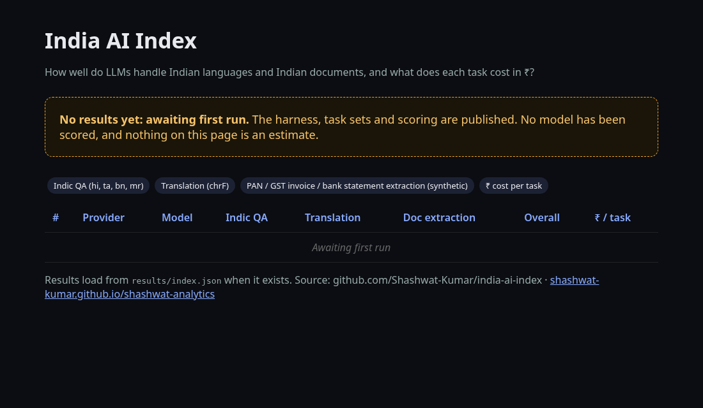
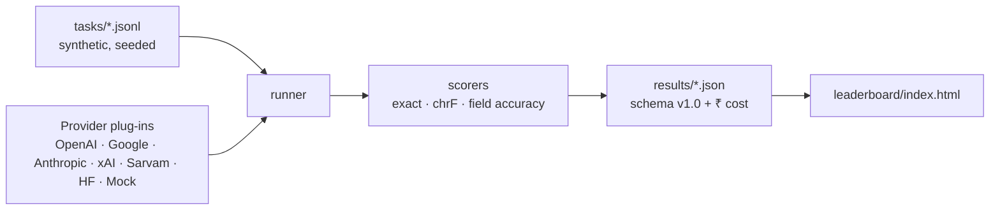

# India AI Index

**An open, reproducible benchmark of how large language models handle India: Indian languages, Indian documents, and the cost of each task in rupees.**

> **Status: harness only, no results yet.** No model has been run. The leaderboard deliberately shows *awaiting first run*. Any score you see here in future will come from a committed results file you can re-run yourself.



## Why
Global leaderboards mostly measure English. Teams building for India need to know: does the model answer correctly in Hindi, Tamil, Bengali or Marathi? Can it read a GST invoice or a bank statement? And what does that cost per task in ₹, not per million tokens in dollars?

## What's inside
| Suite | Items | Languages | Scorer |
|---|---|---|---|
| `indic_qa`: short factual QA | 9 | hi, ta, bn, mr | normalised exact match |
| `translation`: English to Indic | 5 | hi, ta, bn, mr | chrF (character n-gram F-score) |
| `doc_extraction`: PAN card, GST invoice, bank statement → JSON | 15 | en + hi labels | per-field accuracy |

All documents are **synthetic**, generated by `make_tasks.py` with a fixed seed: fictional names, IDs that are invalid by design (`ZZ…` PAN prefix, `99ZZZZZ…` GSTIN), each marked `[SYNTHETIC]`. No real personal data.

This v0.1 set is small, a seed set to prove the pipeline. Reference translations were written for this project and need native-speaker review before results are treated as authoritative (see Roadmap).

## Quickstart
```bash
pip install -e ".[dev,openai]"      # add google / anthropic / hf extras as needed
pytest -q                           # runs offline with a mock provider
iai list-tasks
export XAI_API_KEY=...              # or OPENAI_API_KEY, GOOGLE_API_KEY, ANTHROPIC_API_KEY, SARVAM_API_KEY, HF_TOKEN
iai run --provider xai --model <model-id> --price-in <USD/1M> --price-out <USD/1M> --usd-inr <today's rate>
```
Prices and the exchange rate are **passed at run time and stored in the result file**, because both change. Nothing is hard-coded as fact.

## Providers
`openai`, `google`, `anthropic`, `xai`, `sarvam` (OpenAI-compatible endpoint, override with `SARVAM_BASE_URL`), `hf` (open models via Hugging Face Inference), `mock` (tests). Adding one means subclassing `Provider` and implementing `complete()`.

## Architecture


## Results schema (v1.0)
Each run writes `results/<provider>__<model>.json` with `schema_version, provider, model, run_at, usd_inr, price_usd_per_m, n_items, overall_score (0–1), cost_inr_total, suites{score, cost_inr_per_task}` and per-item rows (score, tokens, latency, ₹ cost). `runner.validate()` checks it. The leaderboard reads `results/index.json` (a list of result objects).

## Roadmap
- [ ] Native-speaker review of all references; grow to 500+ items
- [ ] More languages: Telugu, Kannada, Gujarati, Malayalam, Odia, Punjabi
- [ ] Speech and OCR-from-image tracks (scanned invoices)
- [ ] First published run with full configs, then a weekly refresh
- [ ] Contamination checks and held-out private split

## Contributing

Issues and pull requests are welcome. Please run `pytest -q` before opening a PR, keep changes small and focused, and add a test for any new behaviour. Bigger ideas: open an issue first so we can agree on the shape. New task items are especially welcome: they must be synthetic or openly licensed, and contain no real personal data.

## Licence
MIT. Built by [Shashwat Kumar](https://readsigil.com/).
